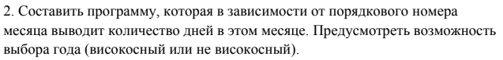
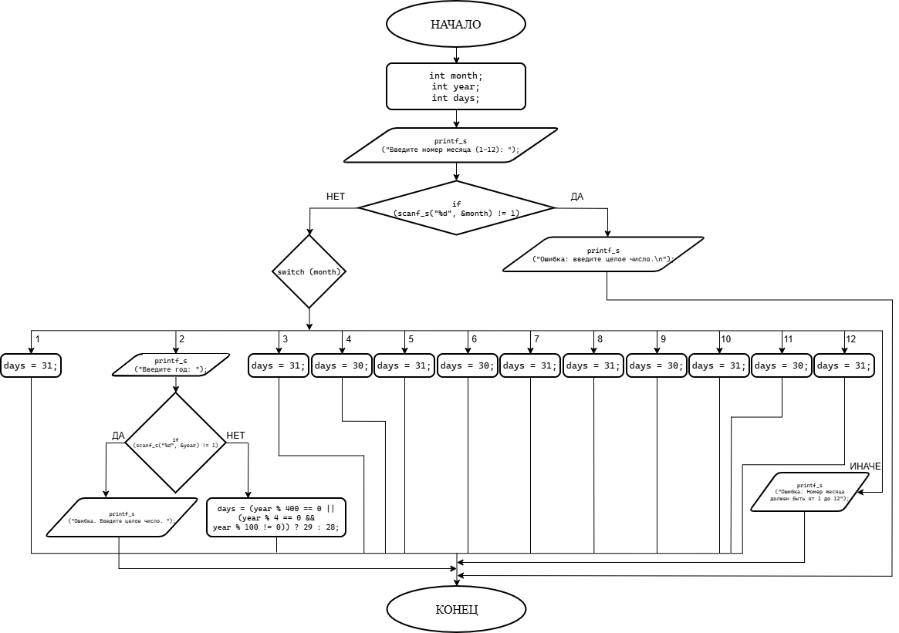
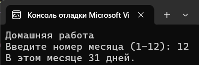
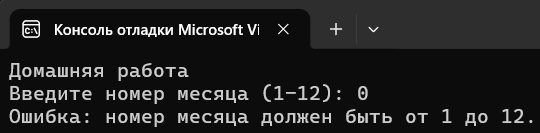
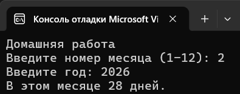

# Домашние задания к работе 7 (Вариант 2) #
## Условие задачи ##



Создать программу определяющую количество дней в месяце, введённом пользователем

## 1. Алгоритм и блок-схема ##

### Алгоритм ###
Алгоритм программы заключается в выводе нужного значения в результате выборки при помощи оператора `switch`
1. **Начало**
2. Объявляем переменную для месяца который будет вводить пользователь:

```c
int month;
```

3. Объявим переменную для определения дней в феврале, относительно года:

```c
int year;
```

4. Объявим переменную для вывода количества дней в месяце:

```c
int days;
```

5. Просим пользователя ввести номер месяца:

```c
printf_s("Введите номер месяца (1–12): ");
```

6. Проводим проверку на ввод целого числа пользователем:

```c
if (scanf_s("%d", &month) != 1)
{
    printf_s("Ошибка: введите целое число.\n");
    return 1;
}
```
* `scanf_s("%d", &month) != 1` — считываем номер месяца и сразу проверяем, что введено целое число.
* Спецификатор `%d` читает именно int, а `&` передаёт адрес переменной <br>
**Если `scanf_s` не смог прочитать число, он вернёт значение, отличное от 1**

7. Вводим оператора множественного выбора, для сравнения со значение переменной, введенной пользователем:

```c
switch (month)
{
case 1:
    days = 31;
    break;
case 2:
    printf_s("Введите год: ");
    if (scanf_s("%d", &year) != 1) {
        printf_s("Ошибка: введите целое число.\n");
        return 1;
    }

    // Високосный год: кратен 400
    // или кратен 4, но не кратен 100
    days = (year % 400 == 0 ||
        (year % 4 == 0 && year % 100 != 0)) ? 29 : 28;
    break;
case 3:
    days = 31;
    break;
case 4:
    days = 30;
    break;
case 5:
    days = 31;
    break;
case 6:
    days = 30;
    break;
case 7:
    days = 31;
    break;
case 8:
    days = 31;
    break;
case 9:
    days = 30;
    break;
case 10:
    days = 31;
    break;
case 11:
    days = 30;
    break;
case 12:
    days = 31;
    break;
default:
    printf_s("Ошибка: номер месяца должен быть от 1 до 12.\n");
    return 1;
}
```
* `days = 31; break;` (в ветках 1, 3, 5, 7, 8, 10, 12) — для месяцев с 31 днём просто присваиваем значение. Команда `break` обязательна: она «выводит» выполнение из `switch`. Без неё код «провалился» бы в следующий `case` и перезаписал `days` следующим значением.
* `case 2` — особая ветка для февраля: сначала дополнительно запрашиваем год (с той же проверкой корректности ввода), затем вычисляем число дней
**Условие високосного года:**
* `year % 400 == 0` — год кратен 400 (например, 2000) — високосный
* `year % 4 == 0 && year % 100 != 0` — год кратен 4, но не кратен 100 (например, 2024 — високосный, а 1900 — нет, потому что кратен 100, но не кратен 400)
* оператор || объединяет оба правила: достаточно выполнения любого из них
* тернарный оператор `?` : работает как компактный `if/else`: если условие истинно — days = 29, иначе days = 28. Это точное григорианское правило: «каждый четвёртый год — високосный, кроме кратных 100, кроме того кратных 400» <br>
**`default` — ветка «во всех остальных случаях»: если пользователь ввёл число вне диапазона 1–12, выводим сообщение об ошибке**

8. После того, как программа определит месяц, выводим количество его дней:

```c
printf_s("В этом месяце %d дней.\n", days);
```
**после выхода из `switch` печатаем результат; `%d` подставляет значение `days`** <br>

9. **Конец**

---

## Блок-схема ##



[Блок-схема алгоритма программы, созданной в draw.io](https://viewer.diagrams.net/?tags=%7B%7D&lightbox=1&highlight=0000ff&edit=_blank&layers=1&nav=1&dark=auto#R%3Cmxfile%3E%3Cdiagram%20name%3D%22%D0%A1%D1%82%D1%80%D0%B0%D0%BD%D0%B8%D1%86%D0%B0-1%22%20id%3D%22Z_DNZ6W32sM9It6xY6CX%22%3E7V1bc%2BI4Fv4t%2B0BV5yEq3W09JiQ9u1MzW1Pbc92XKTc4gW3AGSC3%2BfUr2RZYMmBjbOEYp7rcIOTjiz6d7%2Bgc6WhAhvO375bB0%2BTHaBzOBhiO3wbkboAxotiX%2F6mS96RE8LTgcTkdJ0VwW%2FBl%2BneYnqlLn6fjcJWWJUXrKJqtp09m4ShaLMLR2igLlsvo1az2EM3GRsFT8BjmCr6Mglm%2B9LfpeD1JSxEX2x%2F%2BGU4fJ%2BmlfewlP3wNRt8el9HzIr3eTNW5HgfLb58GmHyO%2FwZ4uPl8lZw2D%2FQ10hewmgTj6DVTRO4HZLiMonXyaf42DGfqnZuv8%2FOeXzfPswwX6zInfH%2F%2FC3m5%2FwFNHn5drtjkZbj69nS9Q0patFq%2F61e3Wi%2Bjb5u3Jm%2F8drKez%2BRHJD%2FKx3pS9eZvjwo44GEWvY4mwXINVmt5%2FFPVeZ1M1%2BGXp2CkKr7KarLsYTqbDaNZtJRFxa9UXie%2Bid1nwPgvOSP5rM54iBbrz8F8OlOI%2FXk6l%2BjD8N%2Fhqzz%2BJ5oHi7TKsSJTaCMuvyev6iWYPaevanAHB%2BIuPkJ1vPG2n8VtfLxPTwqX6%2FAt88rTVvsujObhevkuq0wycOQpil4z2PXTslQKgzT5nvZQlnaetOM8bgRvQSI%2FpDg5AjM4kRuOcx0uD6LoeTkKi%2FGXAVu4GN%2Bo7i6%2FjWbBajUdmXiLe2Ko7g%2FKb%2BHbdP27%2BgxY%2Bu2PtJ76fPeWqXb3nvnyU7iUgFiHy7TseHTlm76wDVnaXstwFqynL%2BbbyzSsrrer5dIr%2FBRN5aveNj3CZtPbIpKGSM%2FKKglbkDAx5HNAPFOU7NWP4TonKobS5sGro4uX0kip0pG1gtksnEVS98wtvZRTWk%2BZNjdOzIBhp6raQk4JDpYjrQKU1FXyGQJMnGm1iirL2w1bPlurt7MMjXfM%2F3pWzBSff%2F2QqtGbgSIZHszVa0krDIPVKBhPA%2FnTj9Eisn%2BOrwljKcmrUjIYwOwp%2FnVzHfnpMf3f%2Ff1w4O27n6elBPrDnyt9X1%2BX%2BpdPumj1JMlk173ufDpdorgg5ovb5MjiI42P%2FkBCzdflOKaP25hWbu%2Fj41CfIqtBXSFbiOLj5%2FjI43JV7RO6Rvhq8962NzdL%2Fv%2BcPEpyr1fmT3GDmG1kl1bgNUoByylAaXwZzEYpN7QS8g5oyJO4zTuC21xy1kfnJ4tW5HgCWOZJVYbCxAPCh9s%2F7JSu%2FAYN6HE4mq6m0eKsFnRFrsFUUeXzOlJK9ufwbZ0CeRZ8DWc%2FydJ1%2FGB3I%2FnaYuJVemMqh2s%2FWBXm0%2FFYvcfbQN7BzjNu0h82Nc%2FEcbPpIrzW%2FUlJIVIOO0hy6sL772jLTwg%2BvZ2RLXNPhnDJR9tfNn3IsMiuyluiLaiYLSvm5O1w%2FnqUQFs90HoZLFa6E6tHjjvc9SrpcarGIlrOg9nOR5ZvcCEthE%2BD3Tx6jlvKlrBxIdWf5xaHWTwmx7lsy8mVLP9HfHmIrgrueA8m9torZSpXMGO8%2FPAcM2IaMdphtiEu3%2BbA2swYcaoZs4gW4UEbZiFv8%2Ffslz%2B2Fo36ujVj4m%2Fv2W%2F24PtYmqlqDCWmQDGZt8RoopAC0%2B7FHqlsNvnE9BAIaItq2FLSjmAHoEQ9KJsCpSdxA1kOlRpdx8LSh%2FJcQxrnwjUwS%2BFwHduwWfDtsslNFKSAzRrqaVF5Y9aE%2BLGozGNHuR1o6pSuwnQkz3TaN60hot%2BexgfNaa3aiE77PS%2Bn7ZLgQuwsusENtSCFvrsWPNlWKeFy%2BeDuE0%2F31dPtgFh%2Fm6YAQQgg36nKxSfbAt1vdGX%2B6Rj0pt0xEKJaw1MrOkigD7QrzVGrkyadZRcbbb5Jo8o2OfBK5FAuzgxMC9DjdD%2B6y7LDX8%2Fvv%2F359%2Btf%2F%2FrfH3z%2B8t9vT9%2Bvv1zTUojpo4F9NLAD0cD7OFrn6wigPKL4eJPG75IH3EYMy8QNN%2BG%2FpNptJoa4qeBlzkXZamDAhos2xwk506WpJM5wzrapwXLdqZtYGd1kaotd%2BiSjpYKvq2j2vA5vtkrFVDF0pypLr5H1YKBWap92qBtRoGuO6MCxobTHPw1jX3ZGbj6gUdeV3sNg6eRC4%2BB9VW%2B%2FrjCvzecNdWh%2BxKAkM7HtkHJo%2BSSBrRsfMLxxk6orXcthIhSDCo7TQTm3Jt%2BhDM45QcEcE%2BdmmJSfnmAJ4j7gjQ2ud0JPO9r7OQn9nIQLmpMgCp%2Bs0RvKTQp4na5HE3nGJx3TPsZCbjpeLfLGtDAtacLM2KPyFzVlSesITO8O3M9QFBLATLdLXFSNptSp1DSrKMFuaQqf2uhF8WBXIdyWIAQhyoCw2xTQqg5jDCwVoKQRtxghvWIoVAwEQAa3fyjXZlV1BAbWXFvKZZFjY7aUB7j3snwYL0vsQpCXUDcACarXrNkR2vZ8w6wpBnR9Vk0pB2FH5iagSu2FvFx76aKNdrPUGWuwwfq1Z3206WKiTUetPSOZuBFt0%2Fox7O%2BICyFmKhFkrR9rVu27WEP2wW1WeWP54ScBSGTs2IpW6y7RZzBbS0116Qj344a4f2POOSF%2FUabFLtFrrp6y95rX5DX3eqf5Aaf5WS66XYmYsa8ya%2Fr2LKTbsXpNxeH3LV47xunvNBSAdgyaZZm0Sk0bijNgZxlBDZpRR00RLorG65GdQ3srE8An%2FiATwgeQ4MGx%2BWmygfpBdnHToJYI%2FUFGbInNSAgCyHRuqpmoNgDL2olSnClL2p%2FUrZGITw57dX6Z5kcAJqIQICa2f%2BakfeZ5lUGKsQeQ6QHjiLgezGgD%2FyIGMycvkCse1yDq56iUwwap9OQoWh9pNbulYMCvr5cTTAEtlNZ0Jy8VaOtSJz99JeWOro6llWx5MXaApdHezk7t7d33PyrKhvkObNt%2FZTswIgJwL%2BO7NJU7l%2FpeZzRz1Zv7UFZjDjF2PseU5Uwi%2B0NHbQutnXPhFBgkUawjQl4nLptqS3SM5V07GJqrKziydJVokJr60Fixm2OHMegDe4HtEaZlYfM2TUWlQmH9DK49C7%2FhboCeQbt7YJ9yN%2BZ0fYpXoyUJAjGk6uniX%2BIf4y%2FeUP3LE4F5Yu4009ee%2F2qJM6ShWETql4dXV7Fw2bIQi%2Fijej7sN6587aVt2HOofcnJ7sYL0L6cAkgzvjxrxn312bSEEyBoZoxgSXY%2FR0HP9%2B8Vcz%2B1trjPFU%2BtJbgY0vUpM1IGvB1xV5FKLVbsiCbctA4bnWBDaE8%2FhWs5KG%2BIfqhaG9Qu%2BunzZ3SZfqBr%2BqGWQ7dZ%2BinlX%2B0I%2FdCG6Mfe1qNZ%2Bul9T8VZMLBnJ%2Fc9gXIY5i1YQFgu6WBPMx%2BUZtwvIPT9QkjXp7RKTUrvCM2whmiGWVlUG6UZesy01QulGQ5FjTTDM4lsz0cztFQz9zTzQWnG%2BWiG6QRkLmiGlvIEd4RmquVFLqYZqdUc0kyfGKWYZvJblZxCM75oA8306VC6TDPORzOcoUJI16e0LikhitcUzVh7gTRLM8ekxL1QmvE8XCPNeB5qA814Pc30NFMfzXiEFEK6PqV1Sbk3%2FEotVkwzUqs5pJl%2BD7BCmvEZrZFmfEZaQDP6LfQ000mace4085HDGWislI7qCM2ISi1WTDNSq7mjGb03UE8z%2B2lGyAaoj2YEoW2gmVJzRXua%2BaA043w04wuH6SRZKY9vR2hGb11TO88IYuu0JnnG73mmcAU%2BRLxGopHiWBuYptR8nZ5pPijTOB%2FQCM%2FhnGZeajTeFaZpKmG9UmzuqEav3u%2Bp5hDViDqnNUtxbZjXzHFPNR2mGueDGgSZw4nN%2FJKWb%2Bpcfw1wjXA4tVkvFu3TCNZFTPGGbSYxcVp9xzaU2%2BeCICAsYU3TUqk5Pn3isT7x2AUkHksfcJNsMs0gNtSZxeS5MK1gFKL4%2BDmThgzmbz%2BTv%2Bw%2Bk30sm7bsTgtPBN7qNGfyONQ%2F3aeFWG0cCA2hsgi3No%2BZvceP8KxMV5or6%2BfBS1r7G4PXz%2BRLjSFy46W5U2uya%2FTM0A2R2Rk04QFyPa0xT14W3Bs1ZsiPS2VsTir2MAK4at6KrTmUkWb37aaNmpMd%2BucHyb4dJNDg8FYAyVMV5%2BSnrUKhtW2kwgwj1RDIISB8m5HFN9HICLcdSU2DsZ2T5RreoeT7%2B1%2FIy%2F0PaPLw63LFJi%2FD1benzdr%2BloCOCQqYhTsItKPueNyZgznPo46RppcgdkTtEZ8YwARqp47K4GwJ5hDjG4RpoFAEYEXQJeLg9s%2FafEQIILxMfiq3eOyDHWXwYIOhGhKUMrMtL1tW0%2B2NO6V%2FmjC7cLsYkFjZxD0k9QWvCEBryg7zoGv%2B68C%2BORn8UWoAEEBIPz79QcoANANXntrJrXJwN5a35T%2FLD8E5EOJs%2FNdn0CwHCJu3SMWhX2zQ08Oymm7zDvinGubAto0CrXRTsfer4vYNHGLD%2BWD5HnhuEkvTaOwdYUVo1DZyS9BoZ6WJvadVPRLEO4BGjpzbZyd7wrqPxna5Ze3kFQqNvGqmBMgO6kbXflm%2FW96yRtDotQqNKnOH3gQjqx4rekw87yAgfeYakCe7yzoPSI2ZlgDSXg17iuno04OmIxWu0dg78wrRSFqFRnvNXKwbq4FRIH4IjM4jW363PHuNjKpZq8Bo7xXAWDxjsxIaKTYdhoy4Hrn4%2FVTqmp0uEAFrVbaiOFGRPNVuOX5Omud2hY9%2F8kbePUiKQKImaPhVA1S7MUepW5ScnKLx%2FChpmspwq2Bo77rGxDblytG7SlqLthhybtd3IEDRKnhQaQ3rhOwbhOQM5GO2HeVFwpqGSAeiBq2DCLYdV3CzlOxoa0eKQyQHEuh2to%2Ffe%2FOLiExP9GsJDHPLTznkwKtoTSGok%2F9sRniuqUwHJz4yAlsFEMEpECgHEVwZImKLrwPymoZJB%2FzqrYOJl1%2Bw4VVDiZJmWdgcMuA51iX444OkaXe3aBUKc4l7GKVVMYggtmQ5H5eJDri4W4UPwWAOHjpeV8HY4YB6hfKaxkjvhq4ZI1TY3KMGZrSiwSMhB6ydE5hj96I42Qnd7GpDlCWmDE%2BdONBqV%2FBLJXYB2Ayacu0jOj5LDDYVGRfINTd1zGeNPBOFXVhY6FkLnYnAlcf2UhaA0JpOQBiTL4ozmP659TaJ3m1dt45iYhORz2Cm6uxO3wfWFjQ7pDUNkt5xXTtI%2FM3aLG0gMbSZhXk8l0l5ws%2FBxJ7h3jRO2pmSoX1Nz4TV9BD4lddm2TCCNbW5%2FLqMVMqrbfVl8DT5MRqHqsb%2FAQ%3D%3D%3C%2Fdiagram%3E%3C%2Fmxfile%3E)

---

## 2. Код программы ##

Ниже приведён код для Задания №1, сделанный на языке С(си).

```c
int Homework()
{
    int month;
    int year;
    int days;
    puts("Домашняя работа");
    printf_s("Введите номер месяца (1–12): ");
    if (scanf_s("%d", &month) != 1)
    {
        printf_s("Ошибка: введите целое число.\n");
        return 1;
    }

    switch (month) {
    case 1:
        days = 31;
        break;
    case 2:
        printf_s("Введите год: ");
        if (scanf_s("%d", &year) != 1) {
            printf_s("Ошибка: введите целое число.\n");
            return 1;
        }

        // Високосный год: кратен 400
        // или кратен 4, но не кратен 100
        days = (year % 400 == 0 ||
            (year % 4 == 0 && year % 100 != 0)) ? 29 : 28;
        break;
    case 3:
        days = 31;
        break;
    case 4:
        days = 30;
        break;
    case 5:
        days = 31;
        break;
    case 6:
        days = 30;
        break;
    case 7:
        days = 31;
        break;
    case 8:
        days = 31;
        break;
    case 9:
        days = 30;
        break;
    case 10:
        days = 31;
        break;
    case 11:
        days = 30;
        break;
    case 12:
        days = 31;
        break;
    default:
        printf_s("Ошибка: номер месяца должен быть от 1 до 12.\n");
        return 1;
    }

    printf_s("В этом месяце %d дней.\n", days);

    return 0;
}
```

---

## 3. Результаты работы программы ##

Для **Задания №1**





---

## 4. Информация о разработчике ##
**Четверня Данил, БТИИ-262**
